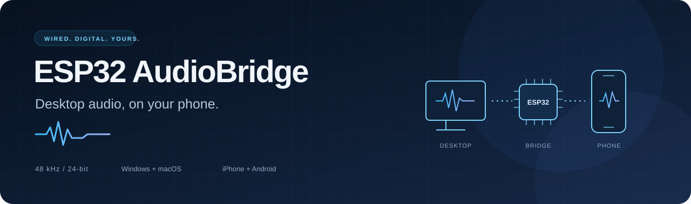

<div align="center">



# ESP32 AudioBridge

**Bring your desktop vocal chain to your phone.**

Post-FX audio from Windows or macOS, delivered to iPhone and Android through an ESP32-S3 USB audio bridge.

[简体中文](README.md) · [Getting started](docs/QUICKSTART.md) · [Hardware](docs/HARDWARE.md) · [Roadmap](#roadmap)

</div>

## What it does

Keep your microphone, audio interface, DAW and effects on your computer. AudioBridge captures the **processed output**, sends framed PCM over a CH343P USB-UART connection, and presents it to the phone as a USB Audio microphone.

- **48 kHz / packed signed 24-bit / mono** is the main release configuration.
- Windows and macOS senders share a versioned UART protocol.
- WAV playback and explicitly selected post-FX capture are supported.
- COBS framing, CRC32, sequence checks and buffer statistics monitor transport integrity.
- Optional SoXR ASRC handles clock drift. ASRC changes samples; stereo-to-mono conversion is explicit.
- Verified mono firmware and a separate 16-bit recovery profile are included.

```text
Microphone → Audio interface → DAW / FX → AudioBridge sender
                                            ↓ USB-UART
                                        ESP32-S3
                                            ↓ USB Audio
                                      iPhone / Android
```

## Device experience

The project user confirms successful **48 kHz / 24-bit / mono** transmission from both Windows and macOS to **iPhone 14 Pro, iPhone 17 and Xiaomi 10**. The longest reported session was approximately **20 minutes**. This is user-reported testing; individual OS, app and adapter versions were not recorded, and the duration is not a separately measured result for every combination.

Preserved development results also include a 60-minute Windows UART + USB bench test, an exact 6-second Mac WAV loopback, and a 60-second Mac realtime test-tone loopback. See [validation and provenance](docs/VALIDATION.md) for their scope.

## Getting started

Create a Python 3.12 or 3.13 virtual environment and install the pinned dependencies:

```bash
python -m pip install -r host/requirements.lock.txt
python -m host.sender ports
python -m host.sender devices
```

The main prebuilt profile is `prebuilt/mono24_2m/`: 48 kHz, 24-bit mono, **2,000,000 baud**. Follow the [setup guide](docs/QUICKSTART.md) to bind your exact device and select a post-FX source. The computer connects to the board's USB-UART port; the phone connects to its native USB port. See [firmware instructions](prebuilt/README.md) before writing an image.

## Roadmap

- [x] Windows and macOS mono audio transmission.
- [x] User testing with iPhone 14 Pro, iPhone 17 and Xiaomi 10.
- [ ] Complete stereo testing across computers, phones and sustained operation.
- [ ] Complete bidirectional audio, including phone backing tracks returned to the computer / audio interface.
- [ ] More features to come.

The newest stereo and duplex sources are kept separately in [`IN_DEVELOPMENT_正在开发中`](IN_DEVELOPMENT_正在开发中/README.md). They have their own profiles and are not the main mono release.

## Development and license

Run `python -m unittest discover -s tests -v` after installing dependencies. See [contributing](CONTRIBUTING.md), [build instructions](docs/BUILD.md), and [source provenance](SOURCE_PROVENANCE.json).

Original project files use the [MIT License](LICENSE). Dependencies retain their own licenses; see [third-party notices](docs/THIRD_PARTY.md).
