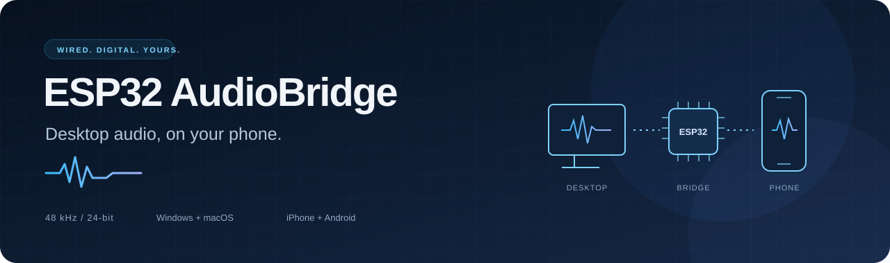
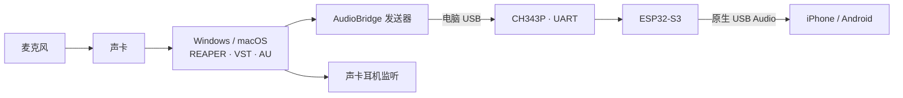

<div align="center">



# ESP32 AudioBridge

**把电脑里的好声音，带到你的手机。**

将 Windows / macOS 机架处理后的音频，通过 ESP32-S3 送入 iPhone 与 Android。


<a href="LICENSE"></a>

[快速开始](#快速开始) · [设备实测](#设备实测) · [硬件连接](docs/HARDWARE.md) · [开发计划](#开发计划) · [English](README.en.md)

</div>

---

## 你的机架，你的声音

麦克风、声卡、REAPER 和熟悉的效果链继续留在电脑端。AudioBridge 捕获**效果处理后的输出**，经 USB-UART 送入 ESP32-S3，再将其作为 USB Audio 麦克风提供给手机。

当前单声道版本已完成 Windows 与 macOS 音频传输验证，并通过 iPhone 14 Pro、iPhone 17 和小米 10 的实际使用测试。适合希望把电脑端人声处理带到手机录音场景的使用者。

| 能力 | 当前提供 |
| :--- | :--- |
| 音频格式 | 48 kHz / packed signed 24-bit / 单声道 |
| 主机平台 | Windows、macOS；已测 Mac 为 Intel MacBook Air |
| 输入方式 | PCM WAV、明确选择的机架效果后实时音源 |
| 数据链路 | USB → CH343P → UART → ESP32-S3 → USB Audio |
| 传输检查 | 版本化协议、COBS、CRC32、序号与缓冲统计 |
| 时钟适配 | 可显式启用 SoXR ASRC，适配电脑与 USB 接收端时钟差 |
| 可恢复性 | 附已验证的 24-bit 单声道固件，以及独立的 16-bit 回退固件 |

音频链路通过线缆传输，不需要 Wi-Fi、蓝牙或额外的 DAC → ADC 环节。启用 ASRC 会改变采样值；立体声源转单声道时，需要明确选择混音方式。

## 一条线缆链路，延续原有工作流



电脑连接开发板的 **COM / USB-UART 口**；手机连接开发板的 **原生 USB 口**。声卡仍连接电脑。接口、供电与手机转接方式见[硬件连接](docs/HARDWARE.md)。

## 设备实测

| 电脑发送端 | iPhone 14 Pro | iPhone 17 | 小米 10 | 音频格式 |
| :--- | :---: | :---: | :---: | :--- |
| Windows | ✅ | ✅ | ✅ | 48 kHz / 24-bit / mono |
| macOS | ✅ | ✅ | ✅ | 48 kHz / 24-bit / mono |

以上手机兼容性来自项目使用者补充确认的实际测试，最长连续使用约 **20 分钟**。该时长是整体反馈中的最长值，并非每个组合均单独记录了 20 分钟。系统版本、录音 App 和转接器型号未逐项留档。

项目还保存有 Windows 单声道 **60 分钟 UART + USB 台架测试**、Mac **6 秒 WAV 完整 PCM 闭环**及 **60 秒实时测试音闭环**的通过记录。各项测试的边界与源码对应关系见[验证说明](docs/VALIDATION.md)。

## 快速开始

### 1. 准备运行环境

准备带 CH343P 的 ESP32-S3 双 USB 开发板、两条合适的数据线，以及 Python 3.12 或 3.13。电脑端还需要能捕获机架输出的音频路由；Mac 示例使用 BlackHole 2ch。

**Windows / PowerShell**

```powershell
py -3.12 -m venv .venv
.\.venv\Scripts\Activate.ps1
python -m pip install -r host/requirements.lock.txt
```

**macOS / Terminal**

```bash
python3.13 -m venv .venv
source .venv/bin/activate
python -m pip install -r host/requirements.lock.txt
```

也可以使用本机已有的对应 Python 版本创建虚拟环境。系统驱动、音频路由和录音权限的准备见[完整上手指南](docs/QUICKSTART.md)。

### 2. 选择固件和设备

主版本使用 `prebuilt/mono24_2m/`：**48 kHz / 24-bit / mono，UART 2,000,000 baud**。首次写入与 16-bit 回退方法见[固件说明](prebuilt/README.md)。

先列出串口和音源，再按真实设备信息创建本机绑定：

```bash
python -m host.sender ports
python -m host.sender devices
python tools/bind_sender.py --port PORT --expected-serial USB_SERIAL --output configs/hardware.local.json --confirm-known-board --execute
python -m host.sender --baud 2000000 hello
```

将 `PORT`、`USB_SERIAL` 替换为枚举结果中的目标开发板端口和序列号。这里的绑定命令只保存本机配置，不写入固件。

### 3. 发送机架效果后的声音

以下为 **Mac + BlackHole 2ch** 示例：先在 REAPER 中播放或输入音频，并把效果后的输出路由到 BlackHole；手机选择 USB 输入并开始录音，然后运行：

```bash
python -m host.sender --baud 2000000 --wait-for-usb 120 capture \
  --source-name "BlackHole 2ch" --source-api "Core Audio" \
  --post-fx-confirmed --input-channels 2 --channels 1 --bits 24 \
  --mix average --asrc --capture-block-frames 480 \
  --capture-latency low --seconds 60
```

`--mix average` 明确将左右声道平均为单声道；也可按实际需求选择 `left` 或 `right`。`Ctrl+C` 停止发送。Windows 请根据 `devices` 输出选择已确认的效果后音源，示例见[上手指南](docs/QUICKSTART.md)。

## 项目结构

```text
ESP32-AudioBridge/
├── host/                            # 已验证单声道主机源码
├── firmware/                        # 对应单声道固件源码与依赖锁
├── prebuilt/                        # 已验证的 24-bit / 16-bit 单声道固件
├── tools/                           # 设备绑定、测试音与检查工具
├── tests/                           # 主版本软件测试
├── docs/                            # 上手、硬件、协议与验证说明
└── IN_DEVELOPMENT_正在开发中/
    ├── 01_stereo_reference/          # 独立立体声参考源码及固件
    └── 02_stereo_duplex_latest/      # 最新双声道 / 双向开发快照
```

主目录面向已经验证的单声道路径。双声道与手机伴奏回传的代码独立保存，具体开发状态见[开发中目录](IN_DEVELOPMENT_正在开发中/README.md)。

## 开发计划

- [x] 完成 Windows 与 macOS 单声道音频传输。
- [x] 完成 iPhone 14 Pro、iPhone 17、小米 10 的单声道使用测试。
- [ ] **完成双声道测试**：保留左右声道与立体声效果，完成跨平台、手机端及稳定性验证。
- [ ] **完成手机与电脑之间的双向传输**：将手机伴奏回传电脑 / 声卡监听，并完善路由与同步。
- [ ] **其他功能，敬请期待。**

## 文档与参与

[完整上手指南](docs/QUICKSTART.md) · [硬件连接](docs/HARDWARE.md) · [编译与恢复](docs/BUILD.md) · [串口协议](docs/PROTOCOL.md) · [验证说明](docs/VALIDATION.md)

欢迎提交可复现的问题、设备使用反馈与改进。请附电脑系统、开发板、手机 / App、固件配置及复现步骤；提交代码前可运行 `python -m unittest discover -s tests -v`。详见[贡献指南](CONTRIBUTING.md)。

## 许可与致谢

项目原创代码采用 [MIT License](LICENSE)。感谢 ESP-IDF、TinyUSB、Espressif USB Device UAC、NumPy、sounddevice、pyserial 和 SoXR 等上游项目。第三方组件保留各自许可，见[第三方说明](docs/THIRD_PARTY.md)。
